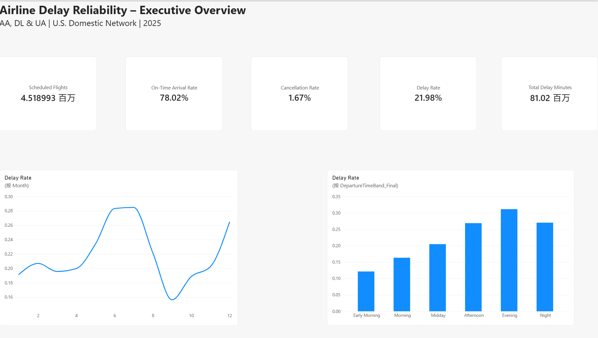
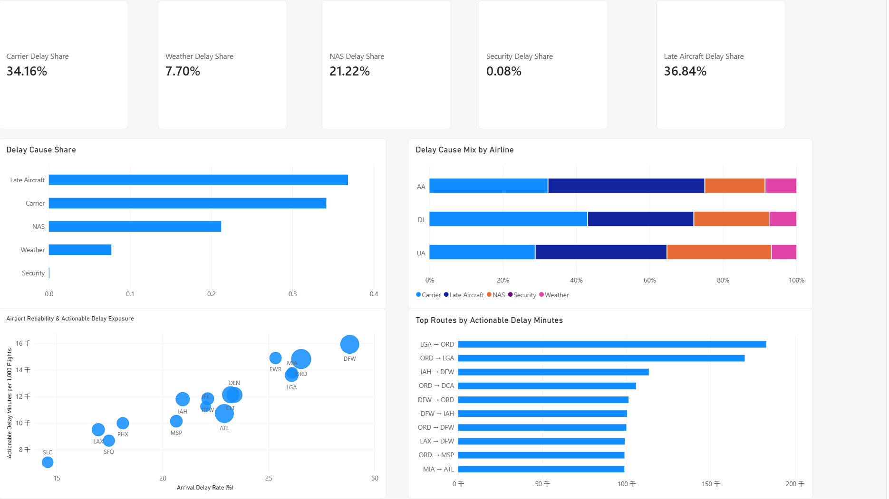
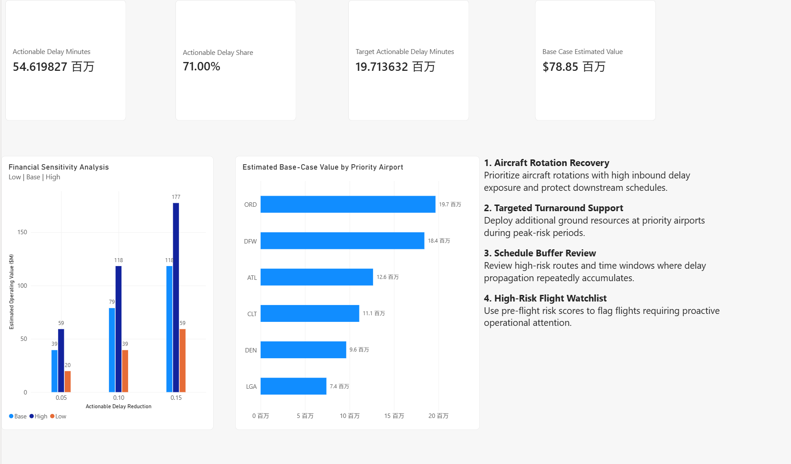

# Airline Delay Reliability Analysis

## Overview

This project analyzes **4.52 million U.S. domestic flights in 2025** operated by American Airlines (AA), Delta Air Lines (DL), and United Airlines (UA) to identify the operational drivers of flight delays, quantify delay propagation across aircraft rotations, predict high-risk flights, and evaluate potential intervention opportunities.

The project combines **SQL, Python, machine learning, network analysis, financial scenario modeling, and Power BI** to move from descriptive analysis to actionable operational recommendations.

## Key Results

- Analyzed **4.52M scheduled flights** across AA, DL, and UA.
- Overall arrival delay rate: **21.98%**.
- Overall on-time arrival rate: **78.02%**.
- **Late Aircraft + Carrier delays accounted for 71.0%** of attributed delay minutes.
- Flights following a delayed inbound aircraft had a **48.41%** delay rate versus **13.82%** when the previous flight was on time.
- This represents a **3.50× higher downstream delay risk**.
- Evening departures recorded the highest delay rate at **31.13%**.
- XGBoost achieved a validation ROC-AUC of **0.6434** using only information available before departure.
- Six priority airports—**ORD, DFW, ATL, DEN, CLT, and LGA**—accounted for approximately **19.71M actionable delay minutes**.
- Under a scenario assuming a **10% reduction in actionable delay minutes** and **$40 operating value per minute**, the estimated operating value is approximately **$78.85M**.

> Financial estimates are scenario-based operating value estimates and do not represent realized savings.

---

## Business Problem

Flight delays create operational costs, reduce network reliability, disrupt aircraft rotations, and negatively affect passenger experience.

This project focuses on four business questions:

1. **Where and when are delays most concentrated?**
2. **Which operational causes contribute most to delay minutes?**
3. **How strongly do delays propagate through aircraft rotations?**
4. **Where should airlines prioritize operational interventions?**

A secondary objective is to determine whether pre-flight information can be used to create a practical **high-risk flight watchlist**.

---

## Dataset

Source:

**U.S. Department of Transportation – Bureau of Transportation Statistics (BTS)**  
Airline On-Time Performance Data

Analysis period:

**January–December 2025**

Airlines:

- American Airlines (AA)
- Delta Air Lines (DL)
- United Airlines (UA)

Total scheduled flights:

**4,518,993**

The analysis includes flight schedules, airports, arrival performance, cancellations, aircraft tail numbers, and official delay-cause categories.

Raw BTS files are not included in this repository because of file size.

---

## Analytical Workflow

### 1. Data Engineering

Monthly BTS files were cleaned and standardized using Python.

The processed data was stored in Parquet format and loaded into MySQL for structured analysis.

A SQL analytical view was created to derive:

- completed arrival flag
- on-time arrival flag
- delayed arrival flag
- departure time band

Indexes were added for flight date, airline, airport, route, and aircraft tail number.

---

## 2. Reliability Analysis

Overall network performance:

| Metric | Result |
|---|---:|
| Scheduled Flights | 4.52M |
| On-Time Arrival Rate | 78.02% |
| Delay Rate | 21.98% |
| Cancellation Rate | 1.67% |
| Average Arrival Delay | 18.29 min |

### Airline Comparison

| Airline | Delay Rate | On-Time Rate |
|---|---:|---:|
| AA | 24.11% | 75.89% |
| UA | 22.02% | 77.98% |
| DL | 19.50% | 80.50% |

Delta recorded the strongest overall arrival reliability among the three airline networks.

---

## 3. Temporal Delay Patterns

Delay risk increased substantially throughout the operating day.

| Departure Time | Delay Rate |
|---|---:|
| Early Morning | 12.14% |
| Morning | 16.33% |
| Midday | 20.47% |
| Afternoon | 26.87% |
| Evening | 31.13% |
| Night | 27.02% |

The pattern is consistent with operational disruption accumulating through daily aircraft and crew rotations.

Seasonality was also substantial, with delay rates peaking in **June, July, and December**.

---

## 4. Root Cause Analysis

Total attributed delay minutes:

**76.93M minutes**

### Delay Cause Composition

| Cause | Share |
|---|---:|
| Late Aircraft | 36.84% |
| Carrier | 34.16% |
| NAS | 21.22% |
| Weather | 7.70% |
| Security | 0.08% |

Late Aircraft and Carrier delays together accounted for approximately:

**71.0% of attributed delay minutes**

These categories represent the largest potential operational intervention opportunity, although they should not be interpreted as fully controllable delays.

The cause structure also differed materially across airlines.

- **AA:** relatively high Late Aircraft exposure
- **DL:** relatively high Carrier Delay exposure
- **UA:** relatively high NAS Delay exposure

---

## 5. Aircraft Rotation & Delay Propagation

Aircraft tail numbers were used to connect consecutive flight legs.

After removing invalid aircraft-time conflicts and incomplete records, downstream delay performance was compared based on whether the aircraft's previous flight had arrived late.

| Previous Flight | Next-Flight Delay Rate |
|---|---:|
| On Time | 13.82% |
| Delayed | 48.41% |

This corresponds to:

- **+34.59 percentage points**
- **3.50× higher downstream delay risk**

A clear dose-response relationship was observed.

| Previous Arrival Delay | Next-Flight Delay Rate |
|---|---:|
| 0–14 min | 13.82% |
| 15–29 min | 30.97% |
| 30–59 min | 50.61% |
| 60–119 min | 61.63% |
| 120+ min | 60.95% |

These results demonstrate a strong association between inbound aircraft delay and downstream operational risk.

---

## 6. High-Risk Flight Prediction

Three models were evaluated:

- Logistic Regression
- Random Forest
- XGBoost

Only variables available before departure were used to avoid data leakage.

### Final XGBoost Validation Performance

| Metric | Result |
|---|---:|
| ROC-AUC | 0.6434 |
| PR-AUC | 0.2982 |
| Precision | 28.80% |
| Recall | 49.48% |
| F1 Score | 0.3641 |

Selected threshold:

**0.24**

At this threshold, approximately **33.5% of flights** were flagged as high risk.

The model is intended as a **risk-prioritization tool**, not a deterministic delay prediction system.

Important predictive feature groups included:

- Origin airport
- Destination airport
- Month
- Departure time band
- Day of week
- Scheduled arrival hour
- Airline

---

## 7. Operational Intervention Priorities

Based on delay volume, actionable delay exposure, airport performance, and propagation risk, six airports were prioritized:

- ORD
- DFW
- ATL
- DEN
- CLT
- LGA

Together, these airports accounted for approximately:

**19.71M actionable delay minutes**

Recommended intervention areas include:

### Aircraft Rotation Recovery

Prioritize aircraft rotations with high inbound delay exposure and protect downstream schedules.

### Targeted Turnaround Support

Deploy additional ground resources at high-priority airports during peak-risk periods.

### Schedule Buffer Review

Review high-risk routes and time windows where operational delay repeatedly accumulates.

### High-Risk Flight Watchlist

Use pre-flight risk scores to identify flights requiring proactive operational attention.

---

## 8. Financial Scenario Analysis

Financial impact was evaluated using multiple assumptions rather than presenting a single savings estimate.

Target airport actionable delay baseline:

**19.71M minutes**

Three delay-reduction scenarios were tested:

- 5%
- 10%
- 15%

Three operating-value assumptions were tested:

- Low: $20/min
- Base: $40/min
- High: $60/min

### Estimated Operating Value

| Reduction | Low | Base | High |
|---|---:|---:|---:|
| 5% | $19.71M | $39.43M | $59.14M |
| 10% | $39.43M | **$78.85M** | $118.28M |
| 15% | $59.14M | $118.28M | $177.42M |

The base case assumes:

**10% actionable delay reduction × $40 per minute**

Estimated operating value:

**$78.85M**

These figures are scenario-based estimates and should not be interpreted as realized profit or savings.

---

## 9. Power BI Dashboard

A three-page Power BI dashboard was developed.
### Page 1 — Executive Overview



### Page 2 — Root Causes & Network Performance



### Page 3 — Intervention & Financial Impact



### Page 1 — Executive Overview

- Scheduled flights
- On-time rate
- Delay rate
- Cancellation rate
- Total delay minutes
- Monthly delay trend
- Airline comparison
- Departure-time risk

### Page 2 — Root Causes & Network Performance

- Delay cause composition
- Airline cause mix
- Airport reliability and actionable exposure
- Top route opportunities

### Page 3 — Intervention & Financial Impact

- Actionable delay exposure
- Priority airport opportunity
- Financial sensitivity analysis
- Base-case airport value
- Operational recommendations

---

## Tech Stack

**Python**
- pandas
- NumPy
- scikit-learn
- XGBoost
- matplotlib

**SQL**
- MySQL
- SQLAlchemy
- PyMySQL

**Visualization**
- Power BI

**Data Storage**
- CSV
- Parquet

**Development**
- Jupyter Notebook
- Git
- GitHub

---

## Repository Structure

```text
airline-delay-reliability-analysis/
│
├── README.md
├── notebooks/
├── sql/
├── data/
│   ├── processed/
│   └── powerbi/
├── figures/
├── docs/
└── dashboard/
```

---

## Key Takeaway

The analysis suggests that airline reliability is not driven by a single source of disruption.

A large share of delay minutes is associated with **aircraft rotation and carrier-related operational factors**, while delay risk increases materially as disruption propagates through the network.

The strongest opportunity is therefore not simply predicting whether an individual flight will be delayed, but combining:

**risk identification + network propagation monitoring + targeted operational intervention**

to prioritize limited operational resources where they can create the greatest potential value.